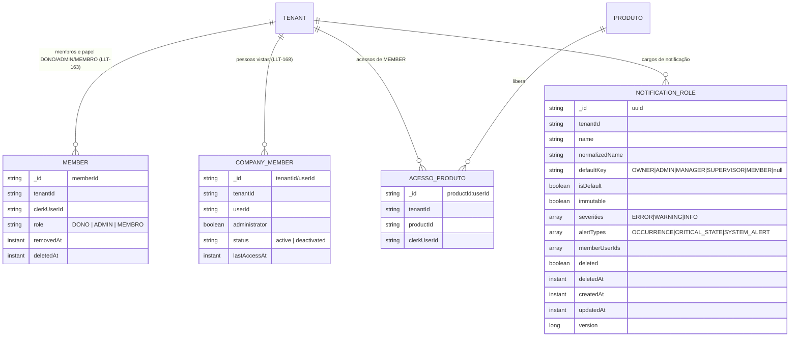

# Modelo de dados: Cargos e permissões

## Visão geral

O `MEMBER`, o `COMPANY_MEMBER` e o `ACESSO_PRODUTO` já existem. Esta feature só lê o `MEMBER` e o `COMPANY_MEMBER`. No `ACESSO_PRODUTO`, grava e remove registros sem mudar o formato.

## Dono e papel de outra pessoa (leitura, sem coleção nova)

Ajuste do clarify de 18/11 (C1): a coleção `CompanyOwner` do pacote foi descartada. O Dono é o `member` da LLT-163 com papel `DONO`.

| Pergunta | Fonte | Regra |
|---|---|---|
| A sessão é OWNER? | token + `member` | token `admin` **e** `member` ativo da sessão com `role = DONO` |
| Quem é o Dono da empresa? | `member` | `tenantId` da sessão, `role = DONO`, `removedAt` e `deletedAt` nulos. Mais de um: o de `clerkUserId` menor, com WARN `event=access.owner.duplicated` |
| Qual o papel de outra pessoa? | `member`, depois `CompanyMember` | `member` ativo: DONO → OWNER, ADMIN → ADMIN, MEMBRO → MEMBER. Sem `member`: `CompanyMember.administrator` → ADMIN, senão MEMBER. Sem nenhum: MEMBER |

- **Leitura isolada:** só o componente `MemberRoleDirectory` (porta em `access/application`, adaptador Mongo em `access/infrastructure`) lê essas duas coleções. Ele consulta a coleção `member` por `MongoTemplate`, sem mudar o módulo `member` da LLT-163. Quando o time unificar `member` e `CompanyMember` (pendência da D1), só esse adaptador muda.
- **Escrita:** nenhuma. O papel `DONO` só é gravado pelo fluxo de compra (ADR_121, spec 003).
- **Nota de 22/11/2026:** o Dono agora nasce pela LLT-289. A confirmação do pagamento grava o `member` DONO de quem comprou (spec `010-criar-tenant-pagamento`, FR-009). Esta feature continua só lendo, sem mudança de formato. O `MongoMemberRoleDirectory` continua sendo o único ponto a trocar na unificação de `member` e `CompanyMember` (D1).
## NotificationRole (novo)

| Campo | Regra |
|---|---|
| `name` | 1 a 60 caracteres depois do `trim` |
| `normalizedName` | `trim().toLowerCase(Locale.ROOT)` |
| `defaultKey` | preenchido só nos cinco padrão |
| `immutable` | `true` só em `OWNER` e `ADMIN` |
| `severities` / `alertTypes` | sem repetição. Personalizado: de 1 a 3 itens. Padrão editável: nasce com 0 (C4); depois, todo `PUT` exige de 1 a 3 (lista vazia dá 400, FR-013) |
| `memberUserIds` | sem repetição, até 200. Sempre vazio em `OWNER` e `ADMIN` (ADR_140) |
| `deleted` / `deletedAt` | exclusão lógica e definitiva |

**Índices**

| Nome | Campos | Opções |
|---|---|---|
| `notification_role_tenant_name` | `{tenantId: 1, normalizedName: 1}` | unique, `partialFilterExpression: {deleted: false}` |
| `notification_role_tenant_default` | `{tenantId: 1, defaultKey: 1}` | unique, `partialFilterExpression: {defaultKey: {$type: "string"}}` |
| `notification_role_tenant_member` | `{tenantId: 1, memberUserIds: 1}` | para FR-019 |

O `spring.data.mongodb.auto-index-creation=true` já está ligado, mas índice parcial pede `@CompoundIndex(partialFilter = ...)`. Se o Spring Data 5.1 não aceitar, crie os índices num `IndexInitializer`, no mesmo padrão do `UsageMongoIndexInitializer`.

**Cargos padrão**

| `defaultKey` | Nome exibido | `immutable` | Listas iniciais |
|---|---|---|---|
| `OWNER` | Dono | sim | vazias (recebe tudo, fixo; ADR_137) |
| `ADMIN` | Administrador | sim | vazias (recebe tudo, fixo; ADR_137) |
| `MANAGER` | Gestor | não | vazias (C4) |
| `SUPERVISOR` | Supervisor | não | vazias (C4) |
| `MEMBER` | Membro | não | vazias (C4) |

Collection: `NotificationRole`. Corresponde ao `PapelNotificacao` + `PapelSeveridade` + `PapelTipoAlerta` das ADR_134/136/142 (C5).

## AccessRole e matriz de permissões

`AccessRole`: `OWNER`, `ADMIN` e `MEMBER`. A tabela abaixo é a fonte do enum `Permission` e do `AccessPolicy`, e é o que `GET /api/company/access` devolve.

| Permission | OWNER | ADMIN | MEMBER | Fonte | Onde vale hoje |
|---|:-:|:-:|:-:|---|---|
| `COMPANY_VIEW` | ✓ | ✓ | ✓ | código atual | `GET /api/company` |
| `COMPANY_EDIT` | ✓ | ✓ | – | LLT-175 | `PUT /api/company` |
| `MEMBERS_VIEW` | ✓ | ✓ | – | LLT-168, USID_029.1 | `GET /api/company/members` |
| `MEMBERS_INVITE_MEMBER` | ✓ | ✓ | – | ADR_114 | Web (Clerk) |
| `MEMBERS_INVITE_ADMIN` | ✓ | – | – | ADR_114, USID_029.1 FA03 | Web (Clerk) |
| `MEMBERS_PROMOTE_ADMIN` | ✓ | ✓ | – | ADR_114 | Web (Clerk) |
| `MEMBERS_DEACTIVATE` | ✓ | ✓ | – | LLT-168 | `POST/DELETE .../deactivation` |
| `PRODUCT_ACCESS_MANAGE` | ✓ | ✓ | – | USID_030.1 | rotas novas da US2 |
| `PRODUCTS_VIEW_ALL` | ✓ | ✓ | – | ADR_122 | lista de produtos |
| `PRODUCTS_CREATE` | ✓ | ✓ | ✓ | código atual (C7) | `POST /api/products` |
| `PRODUCTS_EDIT` | ✓ | ✓ | ✓ só liberados | código atual | `PUT /api/products/{id}` |
| `PRODUCTS_ARCHIVE` | ✓ | ✓ | – | LLT-123 | archive e unarchive |
| `INGESTION_TOKENS_MANAGE` | ✓ | ✓ | – | ADR_109 | LLT-179 (PR #8) |
| `NOTIFICATION_ROLES_MANAGE` | ✓ | ✓ | – | ADR_136/139, USID_052 | rotas novas da US3 e US4 |
| `SUBSCRIPTION_MANAGE` | ✓ | – | – | diagrama v11 [INFERIDO] | ainda não existe no Core |
| `PENDING_ACCESS_APPROVE` | ✓ | – | – | ADR_135 | ainda não existe no Core |

As permissões marcadas "Web (Clerk)" e "ainda não existe" entram na matriz para o Web montar as telas. O Core não as aplica nesta entrega.
